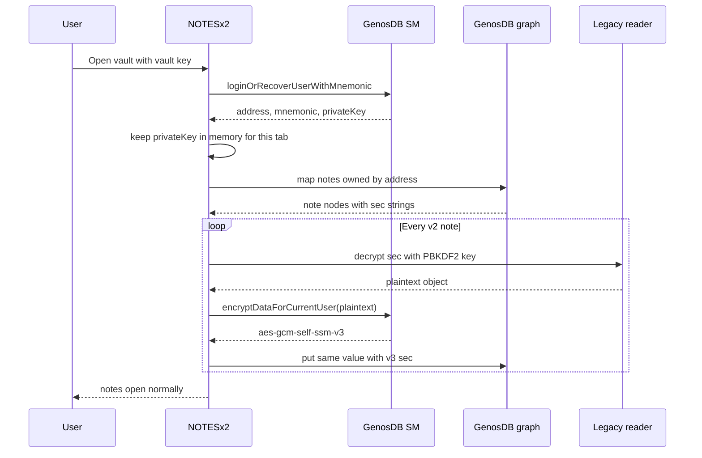
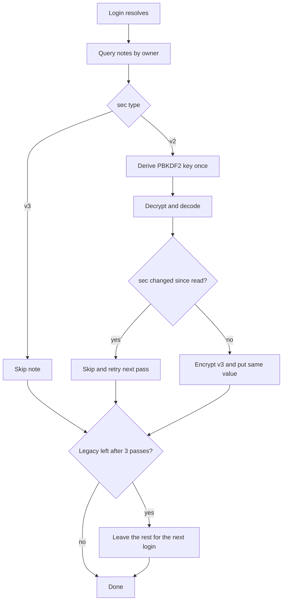

# GenosDB 0.37 migration plan

Upgrade `genosdb` from 0.33.5 to 0.37.0 without losing notes. GenosDB 0.36.0 refuses fields sealed by the old `encryptDataForCurrentUser` recipe. The app reads those fields with the old PBKDF2 recipe and rewrites each note to v3 after the first vault unlock. Passkeys registered before 0.36.0 stop working and are created again once.

M1 adds the v2 reader and the sweep with tests. M2 bumps the engine, wires the sweep, and handles the passkey reset. The rule is simple. A note is written in v3 only after its plaintext has been read and re-encrypted in the same session.

All devices that share a vault must update together. GenosDB 0.34.0 and later refuse live writes from older peers, and 0.36.0 reads only the v3 format.

## How to read this

One box is one unit of work. Every box names the evidence that checks it. A nested box is a sub-step of the box above it. Check a box only when its evidence exists, a file, a log line, a screenshot, a test run, or a SHA. The body is a how-to. The appendices explain and record.

The program runs `skills/poteto-mode/playbooks/autopilot-stack.md` from the installed skill bundle. The operator lands M1 and M2. No owner merges. M2 is review-gated.

Tests alone are not sufficient verification. A PR is verified only when its unit, live, and perf boxes are all checked.

## Program checklist

### Arm the program

- [ ] State the protocol and this plan to the operator, then stop. Start execution only on her explicit go.
- [ ] On her go, write the goal file with this exact text. "Plan `.opencode/plans/genosdb-0.37-migration.md`, PRs M1 then M2, every PR verified by unit, live, and perf evidence, operator lands both PRs, done when M2 is merged and a real 0.33.5 vault opens on 0.37.0."
- [ ] The skeleton names `git show origin/main:<path>`. This repo has no `skills/` directory and its trunk is `master`, so load each skill with the skill tool instead. Re-read them at every tick.
  - [ ] `poteto-mode` playbook `autopilot-stack`
  - [ ] `swarm`
  - [ ] `control-ui`
  - [ ] `poteto-mode` playbook `opening-a-pr`
  - [ ] `how`
- [ ] Run the 30-minute audit tick as a background Task with sleep plus poll. Never leave the cadence to memory.
- [ ] Use this tick prompt, verbatim. "Re-read the execution playbook from the installed bundle and the goal file. Audit the operation against both and fix drift in this tick. Probe every active lane and judge progress by side effects only. Stand down a stuck lane and dispatch its replacement now. Then send the operator a status message, whether or not anything changed, with the queue table of PR, owner, state, and head SHA, the verdicts since the last tick, what merged, open operator gates, and blockers."
- [ ] On the operator's hold or stand-down, send every owner a zero-writes order at once.
- [ ] Before M2 is deployed, export every vault to a zip and store the file outside the browser. The migration rewrites ciphertext in place.
- [ ] Confirm every device that uses the vault can install the new build. M2 is a flag day.
- [ ] Confirm the relay behind `rtc: true` runs GenosSRV 0.12.2. The app hosts no fallback server.

### Spawn owners

- [ ] Spawn one owner per PR with the full lifecycle the execution playbook names.
- [ ] Follow this dependency graph. Start M2 only after M1 merges.
  - [ ] M1 branches from `master`.
  - [ ] M2 branches from `master` after M1 merges.
- [ ] Hold the file boundaries. M1 touches only `src/storage/legacy-crypto.ts`, `src/storage/migration.ts`, `src/storage/migration.test.ts`, `src/storage/fixtures/legacy-sec-v2.json`, `package.json`, `bun.lock`, and `tsconfig.json`. M2 touches only `package.json`, `bun.lock`, `src/storage/db.ts`, `src/storage/user.ts`, `src/storage/notes.ts`, `src/storage/migration.ts`, `src/storage/migration-wiring.test.ts`, `src/components/tab.vue`, `src/components/login.vue`, `src/components/settings.vue`, and `README.md`.
- [ ] Hold the review gate. M2 changes the login and settings interactions. It waits for the operator's review in chat with screenshots and a video before merge.

### PR mechanics, for every PR

- [ ] Open the PR ready, never draft, with `gh pr create` and `draft: false`.
- [ ] Run `bun run type-check` and `bun test` once before the PR-facing push. Push with hooks on.
- [ ] Load the no-comments skill before review.
- [ ] Triage every review-bot comment.
- [ ] Rebase onto current `master` before babysit and again before the merge-ready report.

### Verdict and merge, for every PR

- [ ] At the merge-ready head SHA, run the swarm per the `swarm` skill. One gates lane. The ten live lanes from the PR's **Verify, live** block. The perf lane from its **Verify, perf** block. One audit lane that reads the diff and the receipts and distrusts the PR body.
- [ ] Clean only when every lane is `PASS`. Findings go back to the owner. A new head gets a fresh swarm and a fresh verdict.
- [ ] The root appends the PR to the stack after a clean verdict. The operator lands it. No owner merges.

### Boot recipe, for every live lane

Each live lane runs at the PR head via the Task tool. Drive through the `control-ui` skill.

- [ ] `git fetch origin <head-branch> && git checkout <head SHA>`.
- [ ] `bun install`.
- [ ] `bun run dev`. Wait for `https://notesx2.test` to answer.
- [ ] For upgrade lanes, seed the vault on `master` at 0.33.5 first. Keep the vault key. Then check out the PR head and open the same origin.
- [ ] Deliver input only through the `control-ui` skill's browser commands. Use the app's visible controls. Read `sec` values with the browser console only as a diagnostic.
- [ ] Save every screenshot to `/tmp/swarm-<pr-id>/worker-<n>/<slug>.png` and return the paths with the report.

## Add the v2 note reader and migration sweep (M1)

**Depends on.** None.

**Files.**

- [ ] Create `src/storage/legacy-crypto.ts`.
- [ ] Create `src/storage/migration.ts`.
- [ ] Create `src/storage/migration.test.ts`.
- [ ] Create `src/storage/fixtures/legacy-sec-v2.json`.
- [ ] Edit `package.json`.
- [ ] Edit `bun.lock`.
- [ ] Edit `tsconfig.json`.

**Build.**

- [ ] Generate `src/storage/fixtures/legacy-sec-v2.json` once from `genosdb@0.35.2` with a throwaway mnemonic. Store `address`, `privateKey`, `sec`, and `plaintext`. The identity holds no real data. The fixture is the only oracle for the v2 recipe.
- [ ] Add `hexToBytes(hex: string): Uint8Array` to `src/storage/legacy-crypto.ts`. Strip one leading `0x`, reject odd length, reject non-hex characters.
- [ ] Add `deriveLegacyKey(privateKeyHex: string): Promise<CryptoKey>`. Use PBKDF2-SHA-256, 100000 iterations, UTF-8 encoded salt `ssm-encrypt-for-current-user-v1`, AES-GCM-256, usage `decrypt`, not extractable.
- [ ] Add `isLegacySec(sec: unknown): sec is string`. Return true only when the string parses to an object with `type === "aes-gcm-self-ssm-v2"` and string `iv` and `encrypted` fields.
- [ ] Add `decryptLegacySec(sec: string, key: CryptoKey): Promise<unknown>`. Parse the hex fields, decrypt with AES-GCM, inflate with `pako.inflate`, decode with `decode` from `@msgpack/msgpack`. Accept the result only when it is a non-null object with a string `content` field.
- [ ] Add `MigrationDeps` and `migrateNotes(deps: MigrationDeps): Promise<MigrationReport>` to `src/storage/migration.ts`. Deps are `address`, `privateKey`, `listNotes`, `getNote`, `putNote`, and `encrypt`. Do not import the app database.
- [ ] Add a test-only `sealLegacySec` helper to `src/storage/migration.test.ts` that mirrors the 0.35.2 recipe. Use it to build the unicode, 1 MB, and concurrent cases. The committed fixture stays the independent oracle.
- [ ] Make the sweep idempotent. Skip v3 notes. Skip malformed notes. Skip notes whose `owner` is not `address`. Re-read a note before writing and skip it when `sec` changed. Run up to three passes. Leave any note that still fails for the next login.
- [ ] Write only `value.sec` on migration. Keep `owner`, `created_at`, `updated_at`, `name`, `content`, and every other field byte-identical. A changed `updated_at` would reorder the note list.
- [ ] Count `scanned`, `migrated`, `skipped`, and `failed` in `MigrationReport`. `scanned` counts every note returned by `listNotes`.
- [ ] Edit `package.json` to add `"test": "bun test"`, add `pako` and `@msgpack/msgpack` to `dependencies`, and add `@types/bun` to `devDependencies`. Both crypto packages are runtime imports in `legacy-crypto.ts`.
- [ ] Edit `tsconfig.json` to add `"bun"` to `compilerOptions.types`. The `types` array is explicit, so `vue-tsc` needs it to resolve `bun:test`.
- [ ] Run `bun install` and commit the lockfile change.

**You see.**

- [ ] `bun test src/storage/migration.test.ts` prints ten passing cases.
- [ ] A browser console import of the module prints `{"scanned":500,"migrated":500,"skipped":0,"failed":0}`.
- [ ] No app screen changes.

**Verify, unit.** Tests alone are not sufficient verification. A PR is verified only when its unit, live, and perf boxes are all checked.

- [ ] `src/storage/migration.test.ts` covers the v2 fixture, a wrong key, a v3 note, malformed JSON, an unknown type, unicode content, a 1 MB note, a concurrent change, a second run over the same store, and a note owned by another address. Run `bun test src/storage/migration.test.ts`.
- [ ] `bun run type-check` passes.

**Verify, live.** Tests alone are not sufficient verification. A PR is verified only when its unit, live, and perf boxes are all checked. Ten lanes on the inherited parent model at the PR head, per the boot recipe.

- [ ] Lane 1. Open the app at the M1 head. Import `/src/storage/legacy-crypto.ts` in the console. Decrypt the committed fixture. Save `legacy-read.png`. Pass when the plaintext is `{"content":"hello legacy"}` and `sm().decryptDataForCurrentUser` on the same `sec` throws `Unsupported encryption type or incorrect version`.
- [ ] Lane 2. Sweep 500 copies of the fixture `sec` through `migrateNotes` with an in-memory store. Save `sweep-500.png`. Pass when the report is `{"scanned":500,"migrated":500,"skipped":0,"failed":0}`.
- [ ] Lane 3. Run with a wrong private key. Save `wrong-key.png`. Pass when every note is counted failed, no `putNote` runs, and the error is visible.
- [ ] Lane 4. Run with one v3 note and one v2 note. Save `skip-v3.png`. Pass when the v3 note is skipped and the v2 note is migrated.
- [ ] Lane 5. Run with malformed JSON. Save `malformed.png`. Pass when the note is skipped, the other notes migrate, and the page stays responsive.
- [ ] Lane 6. Run with an unknown `type` value. Save `unknown-type.png`. Pass when the note is skipped and the report counts it.
- [ ] Lane 7. Run with a note whose content is `日本語 😀`. Save `unicode.png`. Pass when the round trip is byte-identical.
- [ ] Lane 8. Run with a 1 MB note. Save `large-note.png`. Pass when the round trip is byte-identical and the page does not freeze for more than two seconds.
- [ ] Lane 9. Return a changed `sec` from `getNote` between the read and the write. Save `concurrent.png`. Pass when the changed note is skipped and the next pass migrates the new value.
- [ ] Lane 10. Run twice over the same store. Save `second-run.png`. Pass when the second run reports `{"scanned":500,"migrated":0,"skipped":500,"failed":0}` and calls `deriveLegacyKey` zero times.

**Verify, perf.** Tests alone are not sufficient verification. A PR is verified only when its unit, live, and perf boxes are all checked.

- [ ] Metric. Wall time for `migrateNotes` over 500 v2 notes with an in-memory store, and the number of PBKDF2 derivations.
- [ ] Probe. Run the sweep ten times at `master` and ten times at the head, interleaved. Record the median. Count `deriveLegacyKey` calls.
- [ ] Baseline. Record the `master` value first. `master` has no sweep, so the baseline is `0 ms` and `0` derivations.
- [ ] Rule. Head median under `2000 ms` for 500 notes and exactly `1` derivation per sweep. Fail at `2000 ms` or `2` derivations.

**Review gate.** None. M1 is not review-gated.

**Merge.**

- [ ] Root's clean verdict at the exact head SHA.
- [ ] Review triage done.
- [ ] Rebased onto current `master` after the verdict, patch-id unchanged.
- [ ] The root appends M1 to the stack. The operator lands it.

## Cut over to GenosDB 0.37 and migrate every vault (M2)

**Depends on.** M1.

**Files.**

- [ ] Edit `package.json`.
- [ ] Edit `bun.lock`.
- [ ] Edit `src/storage/db.ts`.
- [ ] Edit `src/storage/user.ts`.
- [ ] Edit `src/storage/notes.ts`.
- [ ] Edit `src/storage/migration.ts`.
- [ ] Create `src/storage/migration-wiring.test.ts`.
- [ ] Edit `src/components/tab.vue`.
- [ ] Edit `src/components/login.vue`.
- [ ] Edit `src/components/settings.vue`.
- [ ] Edit `README.md`.

**Build.**

- [ ] In `package.json`, pin `"genosdb": "0.37.0"` without a caret and bump `"version"` to `"1.1.0"`. The exact pin keeps a future wire change out of a shared room. The version bump lets the Chrome extension update.
- [ ] Run `bun install` and commit the lockfile change.
- [ ] In `src/storage/db.ts`, before `await gdb(...)`, record whether `gdb_ethereum_material_encrypted_webauthn_v2` exists as `notesx2_legacy_passkey`, then remove that key and `gdb_webauthn_registration_details_v2`. Guard both reads with try/catch. GenosDB 0.37 never reads them, and on a device without PRF they still unwrap the old key.
- [ ] In `src/storage/user.ts`, add `rememberPrivateKey`, `getPrivateKey`, and `forgetPrivateKey`. Call `rememberPrivateKey(identity.privateKey)` in `login()` and call `forgetPrivateKey()` in `logout()`. Do not return the key to components. Keep it for the tab so a note that arrives from an old peer can still be read.
- [ ] In `src/storage/user.ts`, call `migrateNotesForCurrentUser` after the identity resolves and before `login()` returns. It runs on every login and skips v3 notes.
- [ ] In `src/storage/user.ts`, make `tryRecoverAndLogin` return early when `user.state === "authenticated"`. GenosDB 0.37 calls the security callback as soon as it is set, and a resumed passkey session is already active. A second pass would stack another `db.map` subscription.
- [ ] In `src/storage/notes.ts`, make `unwrapNote` catch a failed native decrypt. When `isLegacySec(sec)` is true, derive the key once from `getPrivateKey()` and call `decryptLegacySec`. Cache the derived key in a module promise. Throw `LegacyKeyRequiredError` when no key is held. Do not write from this path. The sweep is the only writer.
- [ ] In `src/storage/notes.ts`, change `useNote` so an initial `null` from `db.get` does not close the tab. Track `arrived`. Call `onRemove` only after a node was seen and then removed, or after five seconds with no node. Clear the timer when a node arrives.
- [ ] In `src/storage/notes.ts`, assign `unsub` before the first callback can run. A null-first callback must not leak the listener.
- [ ] In `src/storage/migration.ts`, add `migrateNotesForCurrentUser(deps)` that takes the database adapter, security manager, address, and private key. It builds the note query, calls `migrateNotes`, and logs `[migration] migrated=<n> skipped=<n> failed=<n>`. Reuse `migrateNotes`.
- [ ] In `src/components/tab.vue`, track `lastSavedContent` in `save()` and apply an incoming merged value. When the note ref changes and `content.value` equals `lastSavedContent`, set `content.value` from the incoming note. When a local edit is pending, keep the local text. Without this the 0.34.0 merge rescue is undone by the next auto-save.
- [ ] In `src/components/login.vue`, show `Passkey needs to be set up again. Open with your vault key.` when `notesx2_legacy_passkey` is set and `hasExistingWebAuthnRegistration()` is false.
- [ ] In `src/components/settings.vue`, check the return of `protectCurrentIdentityWithWebAuthn`. When it returns `null`, show `This authenticator cannot protect a passkey`. When it succeeds, refresh the passkey state instead of relying on `computedAsync`.
- [ ] In `README.md`, add an `Upgrading from 0.33.x` section. State that every device must update, the vault key is required, and passkeys must be created again.

**You see.**

- [ ] The first login with an old vault key prints `[migration] migrated=<n> skipped=<n> failed=<n>` in the console.
- [ ] The note list opens, and a note shows its old content.
- [ ] The note's `sec` string parses to `{"type":"aes-gcm-self-ssm-v3"}`.
- [ ] A vault with only a legacy passkey shows the re-setup notice, not a dead passkey button.
- [ ] Settings creates a new passkey after the sweep, and a non-PRF authenticator shows the inline message.
- [ ] The old passkey keys are absent from `localStorage`.

**Verify, unit.** Tests alone are not sufficient verification. A PR is verified only when its unit, live, and perf boxes are all checked.

- [ ] `src/storage/migration.test.ts` still passes.
- [ ] `src/storage/migration-wiring.test.ts` covers the note query shape for `note` and `code`, a second run that skips every v3 note with zero derivations, and a failed pass that leaves the note untouched.
- [ ] `bun test` passes.
- [ ] `bun run type-check` passes.
- [ ] `bun run build` passes.

**Verify, live.** Tests alone are not sufficient verification. A PR is verified only when its unit, live, and perf boxes are all checked. Ten lanes on the inherited parent model at the PR head, per the boot recipe.

- [ ] Lane 1. Seed a text note on `master` at 0.33.5. Check out M2 and open the same vault with the vault key. Save `m2-open-v2-note.png`. Pass when the note text is visible and the console reports `migrated=1`.
- [ ] Lane 2. Seed a code note on `master`. Open it on M2, edit the code, wait for auto-save, reload. Save `m2-code-note.png`. Pass when the edited code survives and `sec.type` is v3.
- [ ] Lane 3. Open the same note in two updated browser profiles. Type in profile A, then type in profile B within one second. Save `m2-merge.png` on both. Pass when both edits are present after the debounce and neither tab reverts.
- [ ] Lane 4. Create a new vault on M2. Add a note, reload, open it. Save `m2-new-vault.png`. Pass when the note opens and its `sec.type` is v3 from the first write.
- [ ] Lane 5. Open a vault that had a 0.33.5 passkey. Save `m2-passkey-reset.png`. Pass when the login screen asks for the vault key, the old keys are gone, and Settings can create a new passkey after login.
- [ ] Lane 6. Export all notes after migration. Save `m2-export.png`. Pass when the zip opens and contains the note text in plaintext.
- [ ] Lane 7. Corrupt one note's `sec` in the graph. Open the vault. Save `m2-corrupt-note.png`. Pass when the other notes open, the corrupt note shows an error, and the app does not overwrite it.
- [ ] Lane 8. Load the app, go offline, open the vault, migrate, reload offline. Save `m2-offline.png`. Pass when the notes still open offline.
- [ ] Lane 9. Keep an old 0.33.5 tab open after M2 writes v3. Save `m2-mixed-version.png`. Pass when the old tab shows an error and the v3 note is unchanged after a reload on M2.
- [ ] Lane 10. Delete a migrated note, reload, and open the vault. Save `m2-delete.png`. Pass when the note is gone and the other notes remain.

**Verify, perf.** Tests alone are not sufficient verification. A PR is verified only when its unit, live, and perf boxes are all checked.

- [ ] Metric. First-login migration wall time for 500 notes on the real graph, and the number of PBKDF2 derivations.
- [ ] Probe. Seed 500 v2 notes in a test vault on `master`. Measure `performance.now()` around `migrateNotes` at the head. Repeat five times with a fresh vault. Record the median.
- [ ] Baseline. Record the `master` login-to-interactive value first with the same 500-note vault. `master` has no sweep.
- [ ] Rule. Head median under `2000 ms` for 500 notes and exactly `1` derivation. Fail at `2000 ms` or `2` derivations.

**Review gate.** The operator reviews before merge.

- [ ] Copy lane 1, lane 3, and lane 5 screenshots into `.opencode/media/m2-review-<slug>.png`.
- [ ] Record a 30 to 60 second video of the upgrade on a test vault. Save it as `.opencode/media/m2-review.mp4`.
- [ ] Post the screenshots and the video in chat. Stop at merge-ready. Wait for the operator's click.

**Merge.**

- [ ] Root's clean verdict at the exact head SHA.
- [ ] Review triage done.
- [ ] Rebased onto current `master` after the verdict, patch-id unchanged.
- [ ] The root appends M2 to the stack. The operator lands it.

## Close the program

- [ ] Every box above is checked with its evidence.
- [ ] Reply to the operator with the plan path, the PR ids, the verdicts, what merged, and every open risk from Appendix C.

## Appendix A. Prototype evidence

The prototype ran in a throwaway directory at `/private/var/folders/wp/pl9_glzd2cg9jh6m48mhhp_80000gn/T/opencode/gdb-proto`. It served `genosdb@0.35.2` and `genosdb@0.37.0` from one origin and drove Chrome through the `browse` tool. No branch or commit was kept. The fixture recipe comes from this run.

| Question | Result |
| --- | --- |
| Does 0.35.2 produce a v2 field? | Yes. `type` is `aes-gcm-self-ssm-v2`. |
| Does 0.37.0 open it natively? | No. The error is `SM Decrypt: Unsupported encryption type or incorrect version.` |
| Does the PBKDF2 reader open it? | Yes. It returned `{"content":"hello legacy"}`. |
| Does re-encryption round-trip? | Yes. The new tag is `aes-gcm-self-ssm-v3` and decrypt returns the same object. |
| Does `loginOrRecoverUserWithMnemonic` return the private key? | Yes. The keys are `address`, `privateKey`, `mnemonic`. |
| How fast is a 500-note sweep? | 34 ms to derive the key, 54.5 ms to decrypt 500 notes, 261.8 ms to re-encrypt 500 notes. All 500 decrypted. |
| Is the v2 plaintext MessagePack plus deflate? | Yes. `pako.inflate` then MessagePack decode returns the original object. |

To regenerate the fixture, make a throwaway directory, run `bun add genosdb@0.35.2`, and serve `node_modules/genosdb/dist` next to an `index.html`. In the page, import `./dist/index.min.js`, call `gdb("fixture", { password: "fixture", sm: { superAdmins: [] } })`, then `startNewUserRegistration()`, `loginOrRecoverUserWithMnemonic(reg.mnemonic)`, and `encryptDataForCurrentUser({ content: "hello legacy" })`. Save `login.address`, `login.privateKey`, the returned `sec`, and the plaintext.

Unproven. The mixed-version lane depends on the old build staying open while M2 writes. The passkey lane depends on the operator's authenticator supporting the WebAuthn PRF extension. The 500-note timing was measured with an in-memory store, not the OPFS graph.

## Appendix B. Alternatives rejected

The two-step export on 0.35.2 lost. It needs a release that every user must run before upgrading, and `importNotes` is still a stub. The in-app reader uses the same PBKDF2 recipe and was proven against the real 0.35.2 bundle.

A new database name, `nnootteess_v3`, lost. It splits the sync room, doubles local storage, and still requires every device to update. The same flag day costs more code.

Staying on 0.33.5 lost. 0.34.0 fixes lost writes on concurrent edits. 0.36.0 fixes passkey wrapping without PRF and moves key envelopes to HKDF. 0.36.5 fixes unsigned writes from a resumed passkey session.

Bundling the 0.35.2 `sm.min.js` as a legacy decryptor lost. It adds a second engine and a second plugin lifecycle for a 20-line KDF.

Using `db.pako` and `db.decode` lost. They are runtime-only getters that are absent from the typings. Direct `pako` and `@msgpack/msgpack` imports cost about 40 KB and are testable under `bun test`.

A write-back inside `unwrapNote` lost. Reads stay pure, and the sweep is the only writer, so a read cannot race an auto-save.

## Appendix C. Risks

Mixed versions in one vault. M2 is a flag day. The operator updates every device and closes old tabs before the first v3 write. GenosDB 0.34.0 and later refuse live writes from older peers, so a missed device shows errors instead of silently merging.

A passkey-only user without the vault key. GenosDB 0.36.0 cannot read the old passkey layout, so that user is locked out with or without the key cleanup. The README and the release note must say the vault key is required before upgrading.

A note that fails to decrypt. The sweep leaves it untouched, counts it as failed, and retries on the next login. It never writes a guessed value.

A concurrent edit during the sweep. The sweep re-reads the note and skips it when `sec` changed. The next pass migrates the new value. The window is small because the sweep runs before the note list is interactive.

A note that arrives from an old peer after the first sweep. The next login sweeps it. The lazy reader opens it in the current session when the vault key was used. A passkey-only session has no private key and shows the legacy error for that note until the next vault-key login.

A PWA that keeps the old bundle. The update indicator uses `registerType: "prompt"`. The operator must confirm every device reloaded. An old tab cannot read v3.

A stale relay. `rtc: true` depends on the shared relay running GenosSRV 0.12.2 for the 0.37 catch-up fix. Confirm before deploy.

A bundle that grows by `pako` and `@msgpack/msgpack`. Both ship inside `genosdb`, but Vite cannot dedupe a pre-bundled dependency, so the app bundle grows by a full copy. Measure the gzipped delta in M2.

## Appendix D. Links and reading list

Read `CHANGELOG.md` entries 0.34.0 through 0.37.0 and `MIGRATION.md` version notes before editing. Read `docs/genosdb-concurrent-writes.md` for the 0.34.0 merge rule. Read `CRYPTOGRAPHY.md` for the v3 derivation.

Read `src/storage/db.ts`, `src/storage/user.ts`, `src/storage/notes.ts`, `src/components/tab.vue`, `src/components/login.vue`, and `src/components/settings.vue` before editing.

Do not change `src/storage/state.ts`, `src/storage/directory.ts`, or the `owner` field. They carry no encrypted fields, and 0.36.1 accepts their writes only because `owner` rides along unchanged.

M2 gets the `how` skill before editing. M2 gets the `interrogate` skill before the merge verdict. Keep a `decisions.tsv` trail per PR per the `show-me-your-work` skill. Do not commit it.
