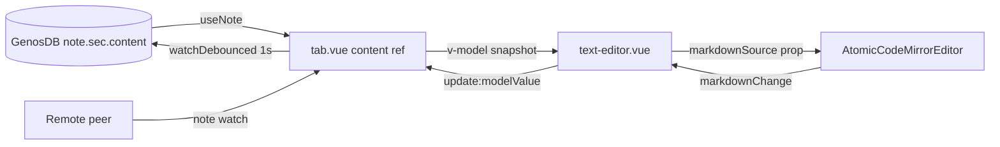
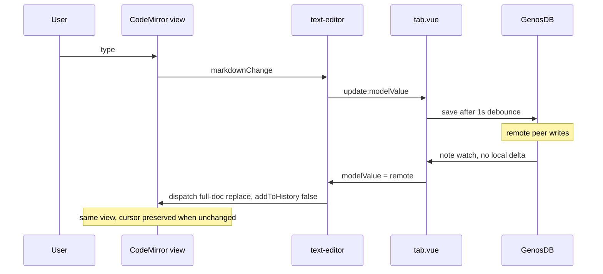
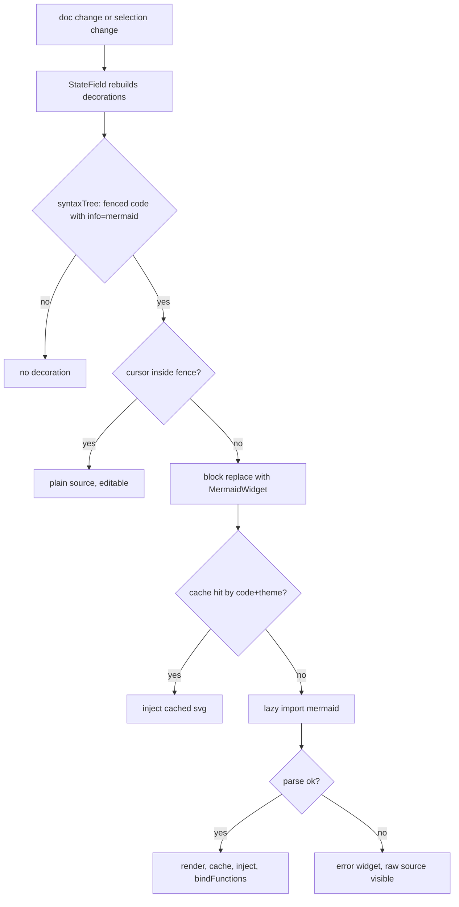

# Markdown editor upgrade

The note editor already is the thing we would have gone looking for. `@atomic-editor/editor` (Vue fork of kenforthewin/atomic-editor, 162 stars upstream) is a CodeMirror 6 live-preview surface with Obsidian semantics: raw markdown stays the document, formatting renders inline, the syntax shows only on the cursor line. The gaps are narrower than "replace the editor". They are mermaid, a broken remote-edit path, focus/link wiring, and a stale README.

Plan: fix the controlled-editor contract, then add a mermaid block extension at app level. No fork changes, no new editor dependency.

## What exists today

Three defects sit in that loop.

1. `src/components/text-editor.vue:66` copies `props.modelValue` into a plain const. The editor never sees a later value.
2. No `documentId` is passed. Atomic keys its view on `documentId ?? markdownSource`, so any reactivated prop rebuilds the view and drops cursor and focus.
3. `@focus` is declared in `src/components/text-editor.vue:61-64` but never emitted. `tab.vue:107` relies on it for `lastFocusedTab` and the document title.

Remote edits already reach `tab.vue` (`src/components/tab.vue:44-53`), and the editor is the only dead end. Mermaid does not exist anywhere in `src/`.

## Options considered

| Option | Live preview | Mermaid | Round-trip | Cost | Verdict |
|---|---|---|---|---|---|
| Keep atomic editor, add app-level extensions | yes | we add it | byte-exact | 2 PRs, no new dep | **chosen** |
| `@latentic/live-markdown-vue` 0.7.0 | yes | built in | byte-exact | 292 KB gz main chunk, 2.15 MB gz total build, 3 stars, published yesterday, no readonly/theme/docId props, KaTeX CDN fallback | evaluate only, do not adopt now |
| `@type32/codemirror-rich-obsidian-editor` | yes | host-rendered | good | 22 peers incl Nuxt UI and Tailwind, conflicts with `mdst-ui` tokens | reject |
| Vditor 4 | yes (IR) | built in, 976 KB | good | own chrome and toolbar, CDN assets by default | reject, fights the minimal UI |
| Milkdown Crepe / TipTap v3 | yes | custom node | lossy, open fidelity bugs | ProseMirror model, bigger | reject, this is what the app moved away from |
| Build CM6 decorations from scratch | yes | yes | byte-exact | weeks of work | reject, atomic already did it |

The latentic spike proved mermaid and KaTeX render offline and remote doc swaps work without remount. It also showed a 292 KB gz main chunk against the current 1.5 MB gz total build, no `readonly` prop, no `docId`, a jsDelivr fallback line, and no proof it survives an MV3 extension build. It is a real option later, not a safer default today.

## M1: controlled editor contract

One PR. Touches `src/components/text-editor.vue`, `src/components/tab.vue`, `README.md`.

Steps.

1. Pass `:documentId="noteId"` (the note id) so the view survives content changes and remounts only per note.
2. Keep `markdownSource` as the mount value. Sync later values by dispatching through `useAtomicEditorHandle().view` when the incoming string differs from `state.doc.toString()`.
3. Annotate the sync transaction with `Transaction.addToHistory.of(false)`. Remote text must not enter local undo.
4. Wrap the editor in a plain div with `@focusin` and emit `focus`.
5. Wire `@linkClick`: wiki link to an existing note opens its tab, external URL goes to `window.open` with `noopener`, unknown wiki target opens the note-not-found path. Keep the handler in `tab.vue`, it owns `notesAPI`.
6. Fix the README stack line. It still says Milkdown Crepe.

Evidence: unit test for the diff-and-skip sync helper, `bun run type-check`, the `verify-notesx2` skill opens two tabs of the same vault, edits in one, and asserts the other updates without a page reload. Focus and title assertions live in the same run.

## M2: mermaid extension

One PR. New `src/editor/mermaid/` module, plus wiring in `text-editor.vue` and token additions in `src/theme.css`.

Implementation notes.

- `StateField<DecorationSet>` with `Decoration.replace({ block: true, widget })`. Block widgets cannot come from a `ViewPlugin`, this is a documented CM6 constraint.
- Skip the fence that contains the selection so arrows into the block reveal source. This is the Obsidian behavior and it removes the need for a separate edit mode.
- Lazy `import("mermaid")` on first render. `initialize({ startOnLoad: false, securityLevel: "strict", layout: "dagre" })`. Dagre keeps the 461 KB gzip ELK chunk out of the app.
- `parse` before `render`. Failures render an error card with the parse message and the source text, never a blank box.
- Cache keyed by `hash(code + theme)`, LRU cap 50. One shared renderer.
- Unique element id per block (`mermaid-${noteId}-${index}-${hash}`). Duplicate ids make mermaid emit blank diagrams.
- Theme from the existing `--mdst-*` tokens through `themeVariables`. Rebuild the field when `data-theme` flips, since mermaid bakes colors into the SVG.
- Click on a diagram moves the cursor into the fence. That is the edit affordance.
- `estimatedHeight` on the widget so scrolling does not jump while diagrams render.
- The note stays markdown. Zip export and P2P sync need no change.

Evidence: screenshots of a flowchart and a sequence diagram in light and dark, an invalid diagram error state, a 2000-line note with 20 diagrams scrolls without measurable jank, `bun run build` shows mermaid in a lazy chunk and no ELK chunk, the extension build opens the same note with diagrams and no network requests.

## M3: optional

Vim in markdown (`@replit/codemirror-vim` first in `extensions`, matching `code-editor.vue`), image paste and drop, math via KaTeX. Each is its own PR and none blocks M1 or M2.

## Non-goals

Say no to a new editor library, a WYSIWYG AST, a split preview pane, frontmatter UI, and HTML rendering. The app's promise is plain markdown in an encrypted graph. Every candidate that rewrites markdown through an AST either loses fidelity or adds a large dependency for features we do not need.

## Open decision

If M2's mermaid rendering feels laggy or the extension emits a lot of lazy chunks in the MV3 build, run the latentic comparison behind a feature flag before writing more widget code. The spike app at `/private/var/folders/wp/pl9_glzd2cg9jh6m48mhhp_80000gn/T/opencode/spike-latentic` is the starting point. Adopt only if it beats the fork on feel, sync, and extension build size.
