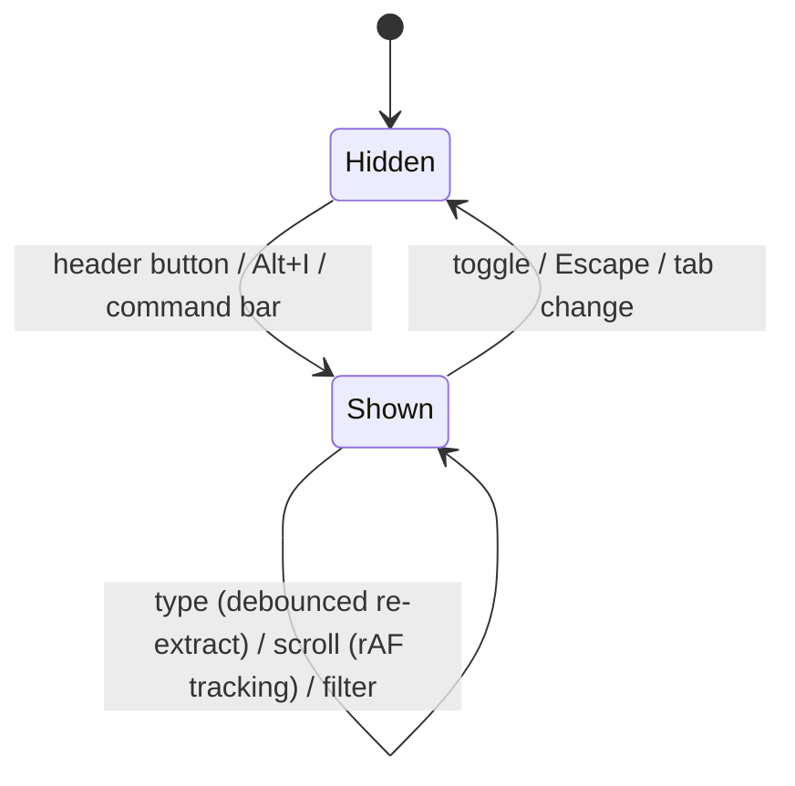
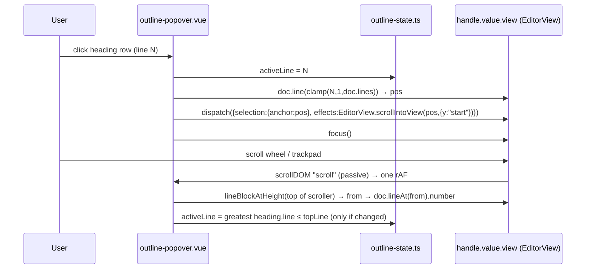

# Simplest Obsidian-like outline for a markdown note

**Recommendation.** Put a small, non-modal outline popover in the note's own `editor-header`, toggled
by a button and by a command-bar action (`Alt+KeyI`), scoped to the active note tab. Compute the
heading list with one pure function over the markdown string. Jump and active-section tracking go
through the `AtomicCodeMirrorEditor` handle's live `view`. Do **not** add a permanent right rail:
this app's editor has a fixed height, split panes halve the width, and the mobile drawer owns the
left edge. A popover reuses the existing `note-actions` popover pattern and leaves layout alone.

```mermaid
flowchart LR
  DB[(note.sec.content)] -->|tab.vue content ref| W[watchDebounced 1s]
  W -->|save| DB
  W -->|markdown snapshot| EX[extractHeadings]
  EX -->|Heading[]| OS[outline-state.ts]
  OS --> OP[outline-popover.vue in editor-header]
  OP -->|click line| CM[EditorView via useAtomicEditorHandle]
  CM -->|scroll event, rAF| ACT[activeLine ref]
  ACT --> OP
```

## 1. What Obsidian actually does

The official page is three sentences: Outline is a core plugin that **lists the headings in the
active note**; **click a heading in the outline to navigate to that section**; **drag a heading in
the outline to rearrange sections**. There is no documented filter, collapse, or settings section
at all ([Outline help](https://publish-01.obsidian.md/access/f786db9fac45774fa4f0d8112e232d67/Plugins/Outline.md)).

| Behavior | Verified Obsidian behavior | Implication for us |
|---|---|---|
| Where it lives | A view in the right sidebar, tied to the active note; desktop tablet shows it in the right sidebar, phone users invoke `Outline: Show outline` and may get a new tab instead ([mobile help thread](https://forum.obsidian.md/t/cant-show-outline-in-right-sidebar-on-android-phone/108564)). | Our header button is tab-local, so it survives split panes; no app-wide sidebar needed. |
| Indentation by level | Heading depth is the outline's structure: `#`–`######` define levels "as shown in the Outline" ([formatting help](https://publish-01.obsidian.md/access/f786db9fac45774fa4f0d8112e232d67/Editing+and+formatting/Basic+formatting+syntax.md)). Users who want deeper visual nesting ask for plugins ([reddit](https://www.reddit.com/r/ObsidianMD/comments/10prth8/is_there_an_option_or_plugin_to_make_the_contents/)). | Indent each row by `level - 1` steps. |
| Click → scroll | "Navigate to that section in the note" (official help). "Snap to top" was a long-standing request, not a documented guarantee ([snap-to thread](https://forum.obsidian.md/t/outline-snap-to-location-in-note-auto-scroll/76991)). | We choose `y: "start"` so the heading lands at the top — a deliberate superset. |
| Current-section highlight | Core highlights the heading under the **cursor**; scrolling with a mouse does not move the cursor, so the highlight does not follow scroll ([highlight thread](https://forum.obsidian.md/t/outline-highlight-the-section-when-scrolled-using-a-mouse-trackpad/78694), [2024 thread](https://forum.obsidian.md/t/outline-snap-to-location-in-note-auto-scroll/76991)). Staff said auto-follow was "intentionally decided not to do"; it was later scheduled for v1.8.1 ([same thread](https://forum.obsidian.md/t/outline-snap-to-location-in-note-auto-scroll/76991)), and in Jan 2025 users still describe that as auto-scroll of the outline *handle*, not selection-sync ([follow-up](https://forum.obsidian.md/t/sync-selected-heading-in-outline-with-document-scroll-position/90436)). | Scroll-based tracking in this app is an intentional improvement. Keep it cheap and only while visible. |
| Filtering / collapse | Absent from core docs; "filter search" and "collapsible groups" are advertised as community-plugin features ([Floating Headings](https://community.obsidian.md/plugins/floating-headings), [Headings](https://community.obsidian.md/plugins/headings)). | Ship one optional text filter and whole-panel hide; no per-subtree collapse in v1. |
| Duplicate headings | Core lists one row per heading occurrence; duplicate names are a known ambiguity for heading links/plugins ([dynamic-toc issue #27](https://github.com/Aidurber/obsidian-plugin-dynamic-toc/issues/27), [forum](https://forum.obsidian.md/t/outline-preview-incorrectly-includes-previous-headings-when-heading-names-are-identical/118209/2)). | Never dedupe; jump uses the stored line number, not the text. |
| Headings in code / frontmatter | Code fences are three+ backticks **or** tildes with an optional info string ([formatting help](https://publish-01.obsidian.md/access/f786db9fac45774fa4f0d8112e232d67/Editing+and+formatting/Basic+formatting+syntax.md)); frontmatter is YAML at the very start of the file ([1.4 changelog](https://obsidian.md/changelog/2023-08-31-desktop-v1.4.5/)). Neither is a heading. | Extraction is a two-state fence scan plus a frontmatter prelude. |
| Setext headings | Obsidian's docs document **only** ATX `#` headings; `===`/`---` underlines are not mentioned ([formatting help](https://publish-01.obsidian.md/access/f786db9fac45774fa4f0d8112e232d67/Editing+and+formatting/Basic+formatting+syntax.md)). | Supporting setext is a deliberate app-level superset; must disambiguate `---` from frontmatter and horizontal rules. |
| Inline markup in heading text | Core showed raw markdown (`[Google](https://google.com)`) in the outline; staff answered "we don't support this" ([bug graveyard](https://forum.obsidian.md/t/outline-contains-markdown-code-for-headers-with-links/31568)). | Our extractor strips inline markdown — better than core, and cheap. |

## 2. Repo fit (read, not changed)

- `src/components/tab.vue:71-119` — each tab is one `.editor-area.mdst-tabs-panel`, a flex column
  with height 100%; `.editor-header` holds the name input and code-only controls; `content` is a
  local `ref` saved with a 1s `watchDebounced`; remote notes replace it only when the local buffer
  matches `lastSavedContent`.
- `src/components/text-editor.vue:75-83` — wraps `AtomicCodeMirrorEditor` with `ref="handle"` but
  **never declares `handle`**; the handle must be wired with `useAtomicEditorHandle()` and exposed
  upward. `@focus` is declared but never emitted (see `.opencode/plans/markdown-editor.md:23-24`).
- `@atomic-editor/editor` handle — `AtomicCodeMirrorEditorHandle.view: EditorView`; the component
  exposes `view` as a **getter** over `runtime?.handle.view` (`AtomicCodeMirrorEditor.ts:163-176`).
  The runtime remounts when `documentId ?? markdownSource` changes (`AtomicCodeMirrorEditor.ts:138-147`),
  so never cache the raw `view`.
- `src/theme.css:497-544,546-584` — split panes are a grid of equal columns; `.editor-area` is a
  fixed-height flex column, and `.atomic-cm-editor` gets `height: calc(100vh - …)` plus its own
  scrollbar. A sibling rail would steal width from an already narrow split pane and force a second
  height override.
- `src/components/note-tabs.vue` + `src/App.vue:129-149` — multiple tabs/panes, each with its own
  editor; `.mdst-tabs-list` is the per-pane tab strip. The outline must be per-tab, not global.
- `src/components/drawer.vue`, `src/components/notes.vue:103,203-205` — the left drawer is a
  `<dialog>`; `useMediaQuery("(max-width: 600px)")` closes it after opening a note.
- `src/components/notes.vue:123-130` and `theme.css:417-441` — established popover pattern
  (`#note-actions`, `showPopover({ source })`, `data-note` on the popover). Reuse it, with
  `mdst-*` tokens only (no Tailwind).
- `src/components/commands/state.ts`, `command-bar.vue:68-78`, `notes.vue:208-228` — `useCommands()`
  registers/unregisters command configs; NOTE_COMMANDS registers while `activeNoteIds.length > 0`.
- Occupied shortcuts: `Alt+C/N/E/O/D/S/V/R/L` (system.ts), `Alt+P`, `Alt+S`, `Alt+Shift+D`
  (notes.vue). **`Alt+I` is free**.
- Tests are colocated and use `bun:test` (`src/storage/notes.test.ts`); `bun test` is the runner.

## 3. Extraction: pure function and data shape

```ts
export interface Heading {
  /** 1–6, from ATX '#' count or setext underline kind. */
  level: 1 | 2 | 3 | 4 | 5 | 6;
  /** Inline markdown stripped; never deduplicated. */
  text: string;
  /** 1-based source line, matching CodeMirror's doc.line(n). */
  line: number;
}

export function extractHeadings(markdown: string): Heading[];
```

Single left-to-right pass, O(n):

1. **Frontmatter prelude.** Only if line 1 is exactly `---` (optional trailing spaces); consume
   through the next `---` or `...` line and emit nothing. A `---` later in the doc is not frontmatter.
2. **Fences.** Track `char: "`" | "~"` and `length >= 3` from the opening line ``^( {0,3})(`{3,}|~{3,})(.*)$``.
   Inside a fence, ignore every line. Close only on the **same character** with at least as many
   repeats and nothing but trailing whitespace after it. Info strings (` ```md `, ` ~~~ts `) are
   ignored, and longer nested fences work. Four-space indented code lines are skipped as a
   conservative extra (accept the documented table/list limitation below).
3. **Inline code guard.** Before matching, replace each backtick run `(`+)(...)\1` with spaces of
   equal length (do this on the line content, preserving offsets). If the `#` is inside a span it
   disappears, so `` `# nope` `` is not a heading; the span's text is still available to the text
   cleaner. Skip `%% … %%` block-comment ranges too (Obsidian-specific, cheap to support).
4. **ATX.** ``^( {0,3})(#{1,6})(?:[ \t]+|$)(.*)$`` — require whitespace/EOL after the hashes so
   `#hashtag` is not a heading; strip trailing ` #…#` closing sequence; trim.
5. **Setext.** A line matching `^( {0,3})(=+|-+)[ \t]*$` emits a heading for the **previous** line
   when that line is non-blank, not itself a heading, not in a fence/frontmatter/comment, and is a
   paragraph line. `=` → level 1, `-` → level 2. Emit with the previous line's number. This
   automatically rejects `---` after a blank line or after a heading (thematic break), and rejects
   the frontmatter delimiters removed in step 1. A repeated `===`/`---` underline only emits once.
6. **Clean text, no dedupe.** Strip `![[target|label]]`/`[[target|label]]` → `label`
   (fallback: last path segment of `target`), `[label](url)`/`` → label/alt, code spans,
   `**`/`__`/`*`/`_`/`~~`/`==` runs, backslash escapes, and optional HTML tags; collapse whitespace
   and trim. Preserve order; duplicates stay as two entries with different `line` values. Return
   `[]` for no headings.

```ts
const sample = `---\ntitle: demo\n---\n# Intro\n## **Team** [[Goals|aim]]\n` +
  "```md\n# not a heading\n```\nSubtitle\n---\n## Intro\n";
// [{ level: 1, text: "Intro", line: 4 },
//  { level: 2, text: "Team aim", line: 5 },
//  { level: 2, text: "Subtitle", line: 8 },
//  { level: 2, text: "Intro", line: 10 }]
```

## 4. Placement: two options, one choice

| | (a) Collapsible right rail inside the editor tab | (b) Header popover + command-bar action — **chosen** |
|---|---|---|
| Where it lives | Sibling of `TextEditor` in `tab.vue`; flex row with `mdst-panel-bg`, width ~200px, toggle in `.editor-header`. | `outline-popover.vue` mounted in `.editor-header`; anchored popover with `popover="manual"`; toggle button + `Outline: Toggle outline` command. |
| Split panes | Each `.editor-area` gets its own rail, but a 200px rail in a half-width pane starves the editor and adds another `height` override on top of `theme.css:565-571`. | Button and popover are inside each tab header; no width lost; two panes can each open their own outline. |
| Tabs | State must be per-tab; risk of two rails fighting over one global `outlineOpen`. | `outline-state.ts` stores `openTabId: number \| null`, so exactly one popover is open, keyed by `tabId`. |
| Mobile (<600px) | Drawer occupies the left; a right rail would overlay or squeeze an editor whose height is hard-coded. Needs a hidden-on-small-screen branch and a second mobile UI anyway. | Popover overlays content like `#note-actions` already does; works at 375px with `max-width: 90dvw`. |
| a11y / shortcuts | Needs focus management between rail and editor; `Alt+I` toggle still useful. | Native popover + ARIA; `Alt+I` free; command bar already routes actions to `lastFocusedTab`. |
| Cost | Layout + CSS + two UIs. | One component, one tiny reactive state module, one command registration. |

Pick **(b)**. It is the smallest shippable slice that behaves Obsidian-like (heading list,
indentation, click-to-jump, current-section highlight) while respecting this app's fixed-height
editor, split panes, and left mobile drawer. `popover="manual"` keeps it open while scrolling so
tracking is visible; close it with the toggle button, Escape, or by switching tab. If a persistent
desktop sidebar is wanted later, the same `extractHeadings` + tracking composable can drive a
rail gated behind `@media (min-width: 600px)` — that is an upgrade, not a rewrite.



## 5. Jump and active-section tracking



Jump sketch (read `handle.value?.view` **at click time**, never cache it — the editor remounts when
its identity changes):

```ts
import { EditorView } from "@codemirror/view";

function jumpTo(view: EditorView, line: number) {
  const target = view.state.doc.line(Math.max(1, Math.min(line, view.state.doc.lines)));
  view.dispatch({
    selection: { anchor: target.from },
    effects: EditorView.scrollIntoView(target.from, { y: "start" }),
    scrollIntoView: true,
  });
  view.focus();
}
```

Tracking sketch:

```ts
const onScroll = () => {
  if (raf !== null) return;               // coalesce every scroll in a frame
  raf = requestAnimationFrame(() => {
    raf = null;
    if (!popoverOpen.value) return;        // no work at all while hidden
    const top = view.scrollDOM.getBoundingClientRect().top - view.documentTop + 8;
    const line = view.state.doc.lineAt(view.lineBlockAtHeight(Math.max(0, top)).from).number;
    const next = lastHeadingLineAtOrBefore(headings.value, line); // binary search
    if (next !== activeLine.value) activeLine.value = next;
  });
};
view.scrollDOM.addEventListener("scroll", onScroll, { passive: true });
```

Notes on the math: `lineBlockAtHeight` expects a height **relative to the document top**, so
`scrollDOM.scrollTop` alone is only correct at scroll zero; subtract `view.documentTop` from the
scroller's viewport top (the `+8` matches CodeMirror's own `scrollAnchorAt`, landing inside the
first visible line). Clamp before the call, and guard `view` freshness on every frame. Avoid
per-frame work by: passive listener + single rAF, binary search over an already sorted array,
writing one `activeLine` ref only on change, no DOM queries, no heading re-extraction on scroll,
and removal of the listener on close/unmount/remount. `prefers-reduced-motion` disables smooth
scrolling.

## 6. Implementation plan

### Files

- **Add** `src/utils/outline.ts` — `Heading`, `extractHeadings`, `cleanHeadingText`, `stripFences`
  helpers. No Vue imports.
- **Add** `src/utils/outline.test.ts` — `bun:test` cases: ATX 1–6, `#hashtag`, closing hashes,
  setext `===`/`---`, `---` as thematic break/frontmatter, fenced ``` and `~~~` with info strings,
  longer/nested fences, indented code, inline-code-only line, links/wiki-links/emphasis/code spans,
  duplicate texts (two distinct `line`s), no headings → `[]`, CRLF.
- **Add** `src/components/outline-state.ts` — `shallowReactive` store with `openTabId: number | null`,
  `activeLine: number | null`, `filter: string`; `toggleOutline(tabId)` and `closeOutline(tabId)`.
- **Add** `src/components/outline-popover.vue` — props `{ headings: Heading[]; tabId: number }`;
  renders filter input, `<ul>` of `<button>` rows with `data-level` indentation and `data-active`,
  empty state; owns the scroll listener and rAF while open; emits `jump`.
- **Change** `src/components/text-editor.vue` — `const { handle } = useAtomicEditorHandle()` bound
  as the component ref; `defineExpose({ getView: () => handle.value?.view ?? null })`; add a
  `documentId` prop and pass it to `AtomicCodeMirrorEditor` so typing does not remount.
- **Change** `src/components/tab.vue` — pass `:document-id="id"`; add the outline button to
  `.editor-header`; derive `headings = computed(() => extractHeadings(content.value))`; mount
  `OutlinePopover` when `outlineState.openTabId === props.tabId`; implement `jumpTo` and wire
  `@focus` (or stop expecting it). The 1s debounce already limits extraction frequency; consider
  an extra `computed` only if profiling shows cost.
- **Change** `src/components/notes.vue` — register `OUTLINE_COMMAND` alongside `NOTE_COMMANDS`
  in the existing `activeNoteIds` watcher (one global registration, avoids duplicate/unregister
  races between tabs). Action calls `toggleOutline(lastFocusedTab.value)`.
- **Change** `src/theme.css` — `.outline-*` styles using `var(--mdst-color-panel-bg)`,
  `--mdst-color-border`, `--mdst-color-fg`, `--mdst-color-muted`, `--mdst-space-*`,
  `--mdst-radius`; `max-height: min(60vh, 400px)`, `overflow-y: auto`, `max-width: 90dvw`.

### Keyboard / a11y

- Toggle button: `aria-haspopup="dialog"`, `:aria-expanded`, `aria-controls="outline-popover"`,
  icon-only button gets `aria-label="Outline"` and a `data-tooltip` like the header buttons.
- Popover: `role="dialog"` + `aria-label="Outline"`, `popover="manual"`; filter input
  `aria-label="Filter headings"`; rows are real `<button>`s in a `<ul>`, `aria-current="true"` on
  the active one.
- On open: focus the filter (or first row); `ArrowDown`/`ArrowUp` move through visible rows,
  `Home`/`End` jump to first/last, `Enter` activates, `Escape` closes and returns focus to the
  toggle; `Tab` cycles inside. Filter matches `text` case-insensitively and keeps all matches.
- `Alt+KeyI` opens the outline for `lastFocusedTab`; command-bar entry `Outline: Toggle outline`
  uses `PRIORITY.high` and an icon (e.g. `CarbonListView`). Do not bind `Cmd/Ctrl+K`.

### Empty / edge states

- No headings → popover shows `No headings in this note` and `Add a heading with # at the start of a line`.
- No open note → command is unregistered by the existing `activeNoteIds` watcher.
- Stale `line` after typing → clamp to `doc.lines` and re-extract from `view.state.doc.toString()`
  at click time if the buffer has changed since the last debounced snapshot.
- Code notes never render an outline button (gate on `note.value.type === "note"`).

### Verification (with `verify-notesx2`)

This design task made no source changes and did not run the app. Implementation should verify:

1. `bun test src/utils/outline.test.ts` and `bun run type-check`.
2. Start only one server on the skill's port: `bun install`, then
   `bunx vite -c vite.app.config.ts --host 127.0.0.1 --port 5173`; confirm with
   `bash .agents/skills/verify-notesx2/scripts/doctor.sh <checkout-dir>` and the
   `Welcome to NOTESx2` login card ([skill](../../.agents/skills/verify-notesx2/SKILL.md)).
3. Create a vault/note through visible controls; type a fixture containing frontmatter, ATX H1–H3,
   a fenced block with `# fake`, a setext `Subtitle\n---`, a `---` horizontal rule, `*em*` and
   `[[Wiki|Label]]` text, and two identical `## Intro` headings.
4. Open the outline via the header button; assert the exact rows/indentation and that the fenced
   and frontmatter lines are absent. Click the second `Intro`; assert the heading is at the top of
   the editor (read the scroll position via `browse.eval`, not internal state).
5. Scroll with the mouse; assert the active row changes without the cursor moving. Filter to a
   substring; assert only matching rows remain. Split the note (`Alt+S`); open an outline in each
   pane and assert they are independent. Check `Alt+I` from the command palette and from the key.
6. Resize to 375px; assert the popover stays inside the viewport and the drawer still works.
   Check keyboard open/arrow/Enter/Escape and focus return.
7. Save screenshots under `.agents/skills/verify-notesx2/evidence/` via `keep-evidence.sh`;
   kill only the started Vite PID, close only the opened tabs, clear the test vault per the skill.

## Risks

1. **Editor remount / stale view.** `AtomicCodeMirrorEditor` remounts when
   `documentId ?? markdownSource` changes; `text-editor.vue` currently has no `documentId` and a
   `ref="handle"` that is never declared. Passing reactive content as `markdownSource` without a
   stable `documentId` would destroy the view on every keystroke, making tracking throw or go dead.
   Always pass `:document-id="noteId"` and read `handle.value?.view` fresh; remove listeners on
   unmount. Also note `@focus` is currently emitted nowhere, so do not anchor focus logic on it.
2. **Heading detection false positives in long/structured notes.** Markdown tables, four-space
   indented blocks, callout contents and block quotes can contain line-leading `#` or `---`;
   a naive scan will show phantom headings. Very long notes (thousands of headings) make a full
   re-extract and a 200-row list expensive — cap rendering behind the filter or virtualize past
   ~500 rows. Include table/callout/indent cases in the test fixture before shipping.
3. **Scroll-coordinate mismatch.** Using raw `scrollDOM.scrollTop` as `lineBlockAtHeight` input is
   wrong once padding/scroll is involved; use the `documentTop` conversion above, clamp, and keep
   the tracking callback to one measurement per frame.
